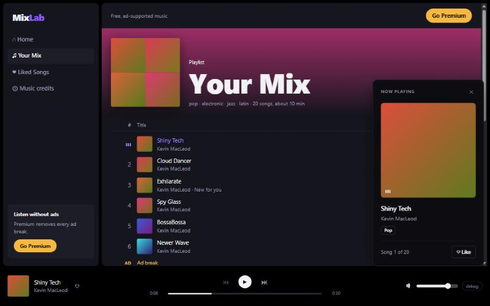
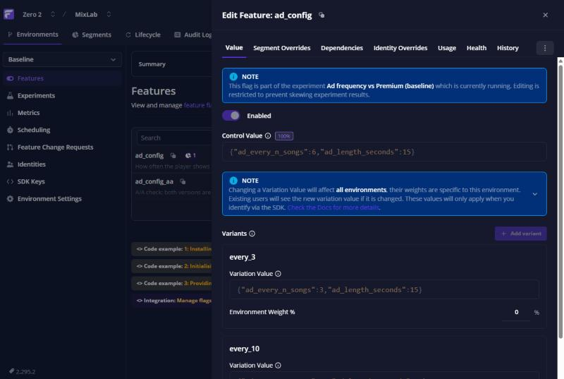
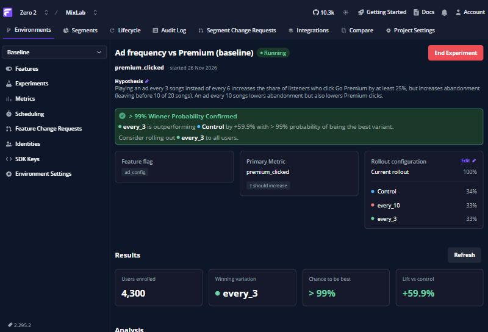
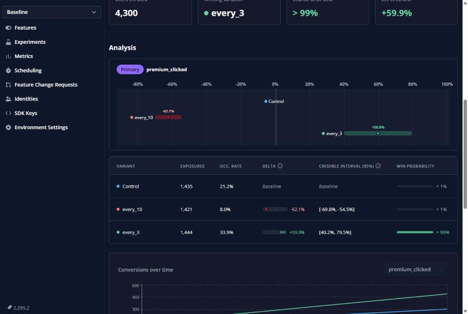
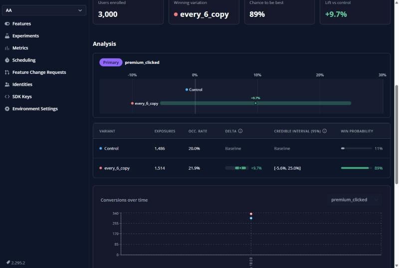
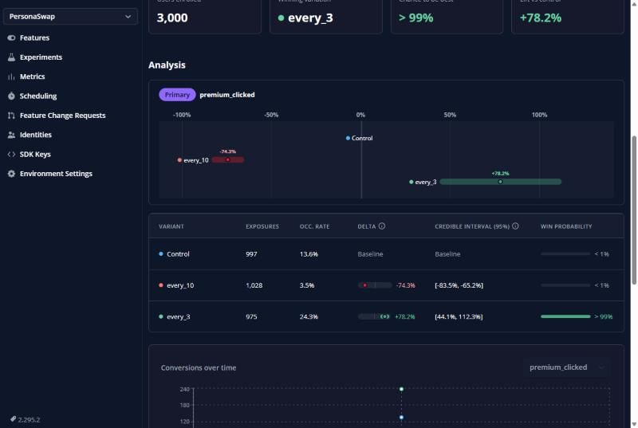
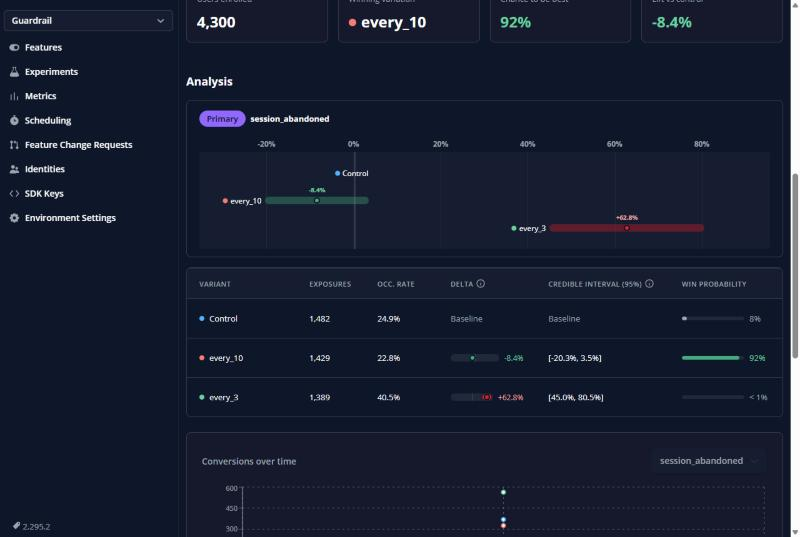

# MixLab — how often should a free music app play ads?

MixLab is a free, ad-supported music player built for **Toggle Wars** (WeMakeDevs × Flagsmith), Track 01. It runs a real A/B test with **Flagsmith Experimentation** on one question every ad-supported streaming app has to answer:

> Play more ads and some listeners pay for Premium to get rid of them. Play too many and listeners leave. **How often should ads play?**

A Flagsmith multivariate flag carries the ad schedule into the player. Simulated listeners go through playlists with ads, and send real `premium_clicked` and `session_abandoned` events through the Flagsmith SDK. Flagsmith Experimentation then reports the win probability, the lift and the credible interval.



**All experiment traffic is simulated.** The organisers allow this. The deployed player is a demo of what each version feels like, and it is not part of the results.

---

## Hypothesis

> Playing an ad **every 3 songs** instead of every 6 increases the share of listeners who click **Go Premium** by at least **25%**, but increases **abandonment**: more listeners leave before hearing 10 of the 20 songs. Playing an ad **every 10 songs** lowers abandonment but also lowers Premium clicks.

| | Metric | Event | Better when |
|---|---|---|---|
| **Primary** | Share of listeners who click Go Premium | `premium_clicked` | higher |
| **Guardrail** | Share of listeners who leave before song 10 | `session_abandoned` | lower |

No real payment is ever taken: Go Premium is a demo button.

## The three versions (one flag)

The flag `ad_config` is a multivariate flag whose values are JSON. Only `ad_every_n_songs` differs between versions, so any difference in results has one cause.

| Version | Value |
|---|---|
| `control` | `{"ad_every_n_songs":6,"ad_length_seconds":15}` |
| `every_3` | `{"ad_every_n_songs":3,"ad_length_seconds":15}` |
| `every_10` | `{"ad_every_n_songs":10,"ad_length_seconds":15}` |



How the flag drives the app, in `packages/blend/src/ads.ts`:
1. `getExperimentFlag('ad_config')` assigns the listener a version and records the **exposure**.
2. `parseAdConfig(value)` reads the JSON. If Flagsmith is unreachable or the JSON is invalid, it falls back to `every_6`, so the app never breaks.
3. `buildSchedule(playlist, config)` puts an ad after every N songs, never after the last one. With 20 songs, `every_3` plays 6 ads, `control` plays 3 and `every_10` plays 1.
4. Each conversion is sent with `trackEvent(name)` under the **same identifier** as the exposure.

## Results

Every number below comes from Flagsmith's experiment results. The exception is the "left before song 10" column in runs 1 and 3, which comes from the simulator's own counts; run 4 checks it with Flagsmith. In every run, Flagsmith's exposure counts and rates matched the simulator's local counts exactly. The raw numbers for each run are in [`results/`](results).

### 1. Baseline: 4,300 listeners (waves of 300, 1,000 and 3,000)




| Version | Listeners | Premium clicked | Lift vs control | 95% credible interval | Chance to be best | Left before song 10 |
|---|---|---|---|---|---|---|
| Control (every 6) | 1,435 | 21.2% | — | — | < 1% | 25.7% |
| **every_3** | 1,444 | **33.9%** | **+59.9%** | **+40.2% to +79.5%** | **> 99%** | **41.3%** |
| every_10 | 1,421 | 8.0% | −62.1% | −69.8% to −54.5% | < 1% | 23.2% |

**In plain English:**
- **Lift +59.9%:** with an ad every 3 songs, the share of listeners who click Go Premium is about 1.6× the control's (33.9% vs 21.2%).
- **95% credible interval +40% to +80%:** given the data, there is a 95% chance the true lift is somewhere in this range. Even the low end beats the +25% target, so **the Premium half of the hypothesis is confirmed**.
- **Chance to be best > 99%:** every_3 is almost certainly the version with the most Premium clicks.
- **The guardrail half is also confirmed, and the cost is large.** every_3 makes 41% of listeners leave before song 10, against 26% for control. Per 100 listeners that is about **13 more Premium clicks but 16 more listeners gone early**. Most of them are casual listeners: 58% of them abandon under every_3, against 27% under control.
- **every_10** keeps only about 2 more listeners per 100 than control, and loses about 60% of Premium clicks. It is the worst version.

### 2. A/A check: 3,000 listeners, two identical versions

Both versions of `ad_config_aa` play an ad every 6 songs. A fair setup should show **no** real difference.



| Version | Listeners | Premium clicked | Lift | 95% credible interval | Chance to be best |
|---|---|---|---|---|---|
| control | 1,486 | 20.0% | — | — | 11% |
| every_6_copy | 1,514 | 21.9% | +9.7% | **−5.6% to +25.0%** | 89% |

**The check passes: the interval includes zero.** Flagsmith's banner still says every_6_copy is "outperforming" control at 89%, yet the two versions are identical. With identical versions, the chance-to-be-best swings around by luck. That is why we read the **credible interval** before trusting a "winner": compare this interval (straddling 0) with every_3's interval in Baseline (+40% to +80%, nowhere near 0). We ran the A/A test once and report it as it came out.

### 3. Persona swap: a budget-heavy audience, 3,000 listeners

The same personas as Baseline, but 60% budget listeners instead of 30%. Does the winner depend on who the listeners are?



| Version | Listeners | Premium clicked | Lift vs control | 95% credible interval | Chance to be best | Left before song 10 |
|---|---|---|---|---|---|---|
| Control (every 6) | 997 | 13.6% | — | — | < 1% | 25.5% |
| **every_3** | 975 | **24.3%** | **+78.2%** | +44.1% to +112.3% | **> 99%** | 36.4% |
| every_10 | 1,028 | 3.5% | −74.3% | −83.5% to −65.2% | < 1% | 25.8% |

The same version wins. Fewer people pay overall, but every_3 still lifts Premium clicks, and the abandonment cost is smaller: about one early leaver per extra Premium click, against about 1.2 in Baseline. Budget listeners tolerate ads (their abandonment barely moves, 25% → 26%), and casual listeners are again the ones who leave. **How much every_3 costs depends on how many casual listeners an app has.**

### 4. Guardrail twin: `session_abandoned` as the primary metric

The Flagsmith wizard allows one metric per experiment, so the Baseline experiment could only judge Premium clicks. To give the guardrail Flagsmith's own analysis, the **Guardrail** environment ran the same 4,300 listeners (same IDs, personas and seeds) with `session_abandoned` as the primary metric. Flagsmith assigns versions per experiment, so the split there is a fresh random draw. That makes it an independent second run of the same test.



| Version | Listeners | Left before song 10 | Change vs control | 95% credible interval |
|---|---|---|---|---|
| Control (every 6) | 1,482 | 24.9% | — | — |
| **every_3** | 1,389 | **40.5%** | **+62.8%** | **+45.0% to +80.5%** |
| every_10 | 1,429 | 22.8% | −8.4% | −20.3% to +3.5% |

- **every_3's cost is real.** Abandonment rises by about 63%, and even the low end of the interval is +45%.
- **every_10 does not clearly keep more listeners.** Its interval includes 0. Flagsmith's banner names it the "winner" at 92%, but as in the A/A check, that only means it is most likely the lowest, not that the difference is real.
- The same run reproduced the Premium result: 20.9% for control, 33.6% for every_3 and 8.4% for every_10, from the simulator's counts.

## What we ship, and why

_To be decided._ Both halves of the hypothesis are confirmed by Flagsmith. every_3 wins on the primary metric (+60% Premium clicks), but it also raises early abandonment by about 63%, which means about 16 early leavers per 100 listeners for about 13 more Premium clicks. every_10 loses about 60% of Premium clicks without clearly keeping more listeners, so it won't ship. The choice is between keeping every_6 and shipping every_3, which depends on whether a Premium click is worth more than an early leaver. Once decided, we end the experiment and serve the chosen value to everyone.

---

## How the simulated listeners work

Each listener is a **persona** with these traits, loaded from `sim/personas/*.yaml`. The values were set **before** any run and have not been tuned to produce a result.

| Persona | Baseline share | Willingness to pay | Ad tolerance | Patience |
|---|---|---|---|---|
| fan | 20% | 0.6 | 0.5 | 3.0 |
| casual | 50% | 0.2 | 0.4 | 2.0 |
| budget | 30% | 0.05 | 0.7 | 2.5 |

Each listener goes through their real playlist and ad schedule, item by item, in `sim/src/listener.ts`:
- **Ad:** annoyance rises by `1.2 × (1 − ⅔ × ad_tolerance)`. Then the listener may click Go Premium, with probability `min(0.9, 0.24 × willingness_to_pay × (1 + annoyance))`. Annoyed listeners with money are the most likely to pay. A Premium listener hears no more ads.
- **Song:** the listener may save it (calming), skip it (irritating) or just listen, depending on how well it fits the genres they picked. There is also a 3% chance per song of leaving for reasons unrelated to the app, the same for every version.
- **Leaving:** if annoyance passes `patience`, the listener leaves. Fewer than 10 songs heard means `session_abandoned` is sent.

The model doesn't know which version a listener got. Any difference between versions comes only from how many ads are in the schedule. Every listener has a stable ID (`sim-<run>-<n>`) and a random generator seeded from `(seed, id)`, so runs are reproducible.

The playlist itself is the same for every version. It is built by a small recommender in `packages/blend`: a taste profile from the picked genres, cosine similarity, genres taking turns, and a few "new for you" tracks from neighbouring genres.

## Run it yourself

Needs **Node 20+** and a Flagsmith account with Experimentation (the managed warehouse).

```bash
git clone https://github.com/0-two/MixLab.git
cd MixLab
npm install
npm test                                  # 37 tests: schedule, recommender, listener model
npm run sim -- --dry-run --listeners 300  # try the model offline, no Flagsmith needed
```

### Flagsmith setup

1. Create a project with one environment per run: `Baseline`, `AA`, `PersonaSwap`, `Guardrail` (plus `Smoke` for pipeline checks and `Live` for the player). The managed Flagsmith warehouse is connected in each.
2. Create the flag **`ad_config`**: a multivariate flag with control value `{"ad_every_n_songs":6,"ad_length_seconds":15}` and variants `every_3` and `every_10` (see the table above). Create **`ad_config_aa`** with one variant, `every_6_copy`, set to the same value as the control.
3. In each environment, create two **Occurrence** metrics: `premium_clicked` (higher is better) and `session_abandoned` (lower is better).
4. In each environment, create an experiment on `ad_config` (`ad_config_aa` in AA) with 100% rollout, an even split, and `premium_clicked` as the primary metric (`session_abandoned` in Guardrail). Launch it.
5. Create a **server-side** key per environment and put it in `.env`:

```bash
cp .env.example .env      # then fill in FLAGSMITH_KEY_BASELINE, FLAGSMITH_KEY_AA, ...
```

### Run the experiments

```bash
npm run sim -- --env baseline    --listeners 3000 --personas sim/personas/baseline.yaml     --seed 44 --run baseline-w3
npm run sim -- --env aa          --listeners 3000 --personas sim/personas/baseline.yaml     --seed 45 --run aa-w1 --flag ad_config_aa
npm run sim -- --env personaswap --listeners 3000 --personas sim/personas/budget-heavy.yaml --seed 46 --run personaswap-w1
npm run sim -- --env guardrail   --listeners 3000 --personas sim/personas/baseline.yaml     --seed 44 --run baseline-w3 --save-as guardrail-w3
```

`--save-as` reuses a run's listener IDs in another environment without overwriting that run's results folder.

The simulator rate-limits itself (8 requests at a time), retries failures, sends events every 100 listeners, prints a summary, and writes `results/<run>/local-summary.json`. Exposures only count while the experiment is **running**, and the tool warns if any listener was not enrolled.

### The player

```bash
cp apps/player/.env.example apps/player/.env.local   # NEXT_PUBLIC_FLAGSMITH_KEY = a client-side environment key
npm run player                                       # http://localhost:3000   (add ?debug for the debug panel)
```

Pick 3–5 genres to get a 20-song mix, with ad breaks wherever your `ad_config` version puts them. The `?debug` panel shows your visitor ID, version, whether you are enrolled, and every event sent. On Vercel, set Root Directory to `apps/player` and add `NEXT_PUBLIC_FLAGSMITH_KEY`.

## Project layout

```
apps/player        Next.js player: genres → 20-song mix, ads between songs, Go Premium, debug panel
packages/blend     playlist recommender + ad schedule (pure TypeScript, no Flagsmith imports)
sim/               listener simulator CLI (real Flagsmith Node SDK)
scripts/           smoke test, catalog generator, music clip cutter
data/              catalog.csv (1,995 synthetic tracks), music.json (CC BY sources)
results/           notes and local summaries for every run
```

## Limitations

- **All listeners are simulated.** The listener model's assumptions (how annoying an ad is, how likely an annoyed listener is to pay) set the size of the effects. The experiment shows how ad frequency plays out *under this model*, and the pipeline is real end to end (real SDK, real events, real Flagsmith statistics). Real people could react differently.
- `premium_clicked` is a click, not a payment.
- Flagsmith allows one metric per experiment, so the guardrail is measured by Flagsmith in a twin environment (run 4) rather than next to Premium clicks in the same experiment.
- Songs are 30-second excerpts, and a session is one 20-song playlist. Real listening is longer and spread over days.
- Ad-supported streaming services publicly discuss the trade-off between ad load, retention and upgrades. This project does not claim that any real company tuned its ad load this way.

## Credits

- **Music:** all tracks by **Kevin MacLeod** ([incompetech.com](https://incompetech.com)), licensed under [Creative Commons: By Attribution 4.0](https://creativecommons.org/licenses/by/4.0/). The tracks were cut to 30-second excerpts with short fades. The full list is on the player's *Music credits* page and in [`data/music.json`](data/music.json).
- Advertisers in the player (Brewly, Northwind, Pixel Pantry) are made up.
- Built with [Flagsmith](https://flagsmith.com) Experimentation and [Claude Code](https://claude.com/claude-code).

## License

[MIT](LICENSE)
